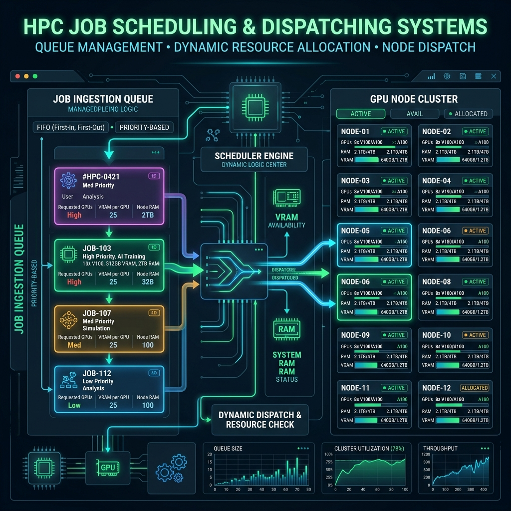

# Cluster Administration and Resilience Guide

This guide details the system administration tasks, architecture resilience features, and configuration requirements for managing the Cluster-CI infrastructure.

---

## 1. RunnerManager and Ephemeral Execution Slots

The GitHub Actions self-hosted runners are managed dynamically by the `RunnerManager` service (`src/scheduler/runner_manager.py`). This component coordinates standard execution slots alongside an exclusive administrative slot.

### Threaded Slots and Staggered Delay
The manager initiates a configured number of standard runner slots (`num_slots`) and one specialized `admin` runner slot. To prevent API rate-limiting and file lock collisions when registering multiple runners simultaneously, the startup of standard slots is staggered:
* Each slot experiences a staggered startup delay of `slot_id * 2` seconds before executing `./config.sh`.

### Provisioning Atomicity and Cleanup
* **Atomic Isolation**: When provisioning a runner folder, the manager copies the runner binaries from `runners/template` to a temporary directory before renaming it to the final slot destination atomically.
* **Configuration Reset**: Before launching the runner process, the manager forcefully cleans up stale state files (such as `.runner`, `.credentials`, etc.) to prevent "already configured" errors.

### Cancellation Loop Watchdog
Standard runners operate with the `--ephemeral` flag, processing exactly one job before exiting. To prevent runners from hanging indefinitely during cancellation cycles, the manager runs an active watchdog:
1. It scans the runner's diagnostic logs (`_diag/Runner_*.log`) every 10 seconds.
2. If it detects continuous job cancellation requests (specifically, 8 or more cancellation request lines in the last 15 lines of the log) OR if the registration becomes unauthorized, it increments a `cancellation_spam_count`.
3. Once the counter reaches 3, the manager kills the process (`process.kill()`) and instantly provisions a fresh runner slot to restore service.

---

## 2. System Prerequisites and Hardware Watchdog

For worker nodes to run reliably under heavy GPU training workloads on Grace Blackwell (GB10) architectures, low-level OS configurations must be properly set.

### Passwordless Sudoers Policy
The system relies on a dedicated sudoers drop-in configuration at `/etc/sudoers.d/cluster-ci` (`src/cluster/setup_runner.sh:144`):

```text
Defaults:$USER !requiretty
$USER ALL=(ALL) NOPASSWD: /bin/systemctl restart cluster-runner-manager, /bin/systemctl restart cluster-scheduler, /bin/systemctl restart cluster-scheduler-loop, /bin/systemctl restart cluster-worker, /usr/bin/systemctl restart cluster-runner-manager, /usr/bin/systemctl restart cluster-scheduler, /usr/bin/systemctl restart cluster-scheduler-loop, /usr/bin/systemctl restart cluster-worker, /usr/bin/dmesg, /bin/dmesg, /usr/bin/journalctl, /bin/journalctl
```

This enables the unprivileged cluster agent user to restart the 4 core services and query system telemetry without interactive password prompts.

### Architecture of the 4 Real Systemd Services
Cluster-CI infrastructure is decoupled into 4 dedicated systemd units:

1. **`cluster-scheduler.service`**: Hosts the Flask/FastAPI REST API on the Headnode (`src/scheduler/headnode_service.py`), handling job submissions, health checks, log queries, and the Web Dashboard.
2. **`cluster-scheduler-loop.service`**: Runs the decoupled, autonomous scheduling and preemption evaluation engine (`src/scheduler/scheduler_loop.py`), ranking jobs every 5 seconds.
3. **`cluster-runner-manager.service`**: Manages ephemeral GitHub Actions self-hosted runners (`src/scheduler/runner_manager.py`), auto-healing hung or cancelled slots.
4. **`cluster-worker.service`**: The worker execution daemon (`src/scheduler/worker_agent.py`), deployed on dedicated compute nodes (`HEC45801`, `HEC45803`) and in dual-mode on the Headnode (`isipol09`).

### Systemd Service Hardening (`10-headnode-guard.conf`)
To safeguard critical scheduler daemons from eviction during severe memory pressure, a systemd drop-in configuration `10-headnode-guard.conf` is installed on all core services (`/etc/systemd/system/*.service.d/10-headnode-guard.conf`):

* **`OOMScoreAdjust=-900`**: Immunizes the service against the Linux kernel OOM Killer, ensuring the kernel terminates user compute containers before ever touching the scheduler or worker agent.
* **`MemoryLow=2G` & `MemoryMin=512M`**: Reserves memory protection guarantees from kernel page reclaim.
* **`CPUWeight=1000` & `CPUShares=2048`**: Guarantees maximum CPU scheduling priority for cluster daemons over batch workloads.

### Cgroup Host Memory Isolation (`cluster-jobs-cgroup.service`)
To ensure Docker execution containers cannot starve the operating system, `setup_runner.sh:248-283` installs a persistent boot service `cluster-jobs-cgroup.service`:

* Creates `/sys/fs/cgroup/cluster-jobs` (supporting both cgroup v1 and v2).
* Sets a hard aggregate memory ceiling: `memory.max = MemTotal - 16.0 GB` (or `memory.limit_in_bytes`).
* Sanctuaries **16 GB of physical RAM** exclusively for the Linux OS, SSH access, and Headnode daemons. All user containers are executed under `--cgroup-parent=/cluster-jobs`.

### Systemd Hardware Recovery Watchdog
NVIDIA Grace Blackwell architectures can suffer from kernel panics or physical freezes when CUDA drivers crash under extreme memory allocation conditions. To prevent physical server hangs, systemd's hardware watchdog interface is configured in `/etc/systemd/system.conf`:
* `RuntimeWatchdogSec=30`: Directs systemd to ping the hardware watchdog device (e.g., `/dev/watchdog`) every 30 seconds. If the kernel freezes and systemd fails to "pet" the watchdog, the motherboard's hardware controller triggers a hard reboot of the machine.
* `RebootWatchdogSec=60`: Configures a 60-second watchdog timer during reboot sequences to recover from hangs at shutdown.

---

## 3. Maintenance Mode and Infrastructure Resilience

The headnode scheduler API provides a Maintenance Mode to allow administrators to perform upgrades or hardware maintenance without losing queued jobs.

### State Management and API Control
* **In-Memory Variable**: The active maintenance state is stored in an in-memory global variable (`MAINTENANCE_MODE = False`).
* **Endpoints**: Maintenance mode is toggled via:
  - `POST /maintenance/on`
  - `POST /maintenance/off`
* **Authorization**: Requests to these endpoints require Bearer token authorization using the `CLUSTER_TOKEN` environment variable.

### Job Suspension Behavior
When maintenance mode is enabled:
* The scheduler loop suspends worker assignments.
* Any call to the `/submit_job` endpoint is rejected.
* The API returns:
  `503 Service Unavailable` with body `{"error": "Service Unavailable: Maintenance Mode Active"}`.
  
This ensures researchers receive immediate feedback, and no new tasks enter the queue while workers are undergoing system updates.

### Critical Infrastructure Environment Variables
To ensure resilience, the scheduler and worker agents rely on several critical environment variables:
* `CLUSTER_TOKEN`: Bearer token used for authenticating administrative actions and API communications between workers and the headnode.
* `HEADNODE_URL`: The base URL of the headnode scheduler API (e.g., `http://10.0.0.1:5000`).
* `GC_FREE_SPACE_THRESHOLD_GB`: Minimum free disk space in GB on the worker before tiered garbage collection is triggered (defaults to 100).
* `DVC_VIEWER_TIMEOUT_MIN`: Idle timeout in minutes for DVC visualizer instances before they are automatically terminated (defaults to 30).

---

## 4. CI SSH Configuration

The GitHub Actions orchestrator needs access to the physical cluster headnode to submit jobs on behalf of researchers.

1.  The project administrator configures a dedicated SSH private key as a GitHub Repository Secret named `CLUSTER_SSH_PRIVATE_KEY`.
2.  This key matches the public key authorized on the cluster's headnode, allowing the GHA runner to execute `submit_job.py` and communicate with `/api/jobs` endpoint securely.

---

## 5. Passwordless Inter-Worker SSH (RSA Headless Setup)

To facilitate distributed computing and peer-to-peer (P2P) artifact sharing, the cluster workers require passwordless SSH communication between each other.

*   **Key Generation**: During worker provisioning, a standard RSA key pair without a passphrase is created:
    ```bash
    ssh-keygen -t rsa -b 4096 -f ~/.ssh/id_rsa -N ""
    ```
*   **Authorization Distribution**: The public key (`~/.ssh/id_rsa.pub`) of each worker must be appended to the `~/.ssh/authorized_keys` file of all other workers in the cluster.
*   **Host Key Verification**: To prevent interactive prompts blocking automated jobs, add the hostkeys or configure `StrictHostKeyChecking accept-new` in the worker configuration:
    ```text
    Host 10.0.0.*
        StrictHostKeyChecking accept-new
        IdentityFile ~/.ssh/id_rsa
    ```

---

## 6. Cluster Maintenance & Upgrades: `cluster-update`

The `cluster-update` CLI tool is installed into `$HOME/.local/bin/` (with a `.cmd` wrapper on Windows) to orchestrate software updates and maintenance operations across all cluster machines.

### Execution Modes

#### Managed Drain Mode (`--queue`, Default)
The recommended, safe method for rolling out updates across workers:
```bash
cluster-update --queue
```
*   **Draining Barrier**: Calls `POST /api/maintenance/submit` on the Headnode.
*   **Non-Disruptive**: Waits for currently running user computation jobs to complete naturally while blocking new jobs from starting.
*   **Rolling Upgrade**: Updates worker daemons, pulls fresh runtime container images, and restarts systemd services (`cluster-scheduler-loop`, `cluster-worker`, `cluster-runner-manager`).
*   **Interactive Monitoring**: Streams live maintenance progress to your terminal with automatic recovery if network connections drop temporarily.

#### Emergency Direct Mode (`--force`)
When the scheduler API is unresponsive or urgent hotfixes are required:
```bash
cluster-update --force
```
*   Bypasses the queue and Headnode API entirely.
*   Directly connects via SSH across all physical nodes (`isipol09`, `HEC45801`, `HEC45803`).
*   Applies code updates and restarts cluster services immediately.

### CLI Options Reference

```text
cluster-update [--queue | --force] [--branch BRANCH] [--target-repo REPO] [--headnode-url URL] [--token TOKEN] [--description DESC] [--no-wait] [--add-worker HOST]
```

| Flag | Default | Description |
| :--- | :--- | :--- |
| `--queue` | *(default)* | Submit a queued maintenance job with worker draining. |
| `--force` | `false` | Bypass queue and execute direct SSH update across all machines. |
| `--branch` | `main` | Target Git branch of Cluster-CI to deploy. |
| `--target-repo` | `UNIL-DESI/cluster-ci` | Target Git repository for the update. |
| `--headnode-url` | `http://130.223.73.209:5000` | Headnode API base endpoint. |
| `--token` | `$CLUSTER_CI_TOKEN` | Cluster authentication token. |
| `--description` | `"Cluster upgrade"` | Audit note attached to the maintenance event. |
| `--no-wait` | `false` | Submit the queued update job and exit immediately without streaming progress. |
| `--add-worker` | `null` | Register and provision a new physical worker node into the cluster. |

---

## 7. Scheduling Queue and Job Dispatch Flow

Below is the schema outlining how jobs enter the execution queue, how placement constraints are evaluated by the scheduler, and how workers are allocated to execution slots.



---

## 8. Adding Worker Nodes & Hardware Telemetry (v3)

Cluster-CI v3 implements **fully automated capability discovery**. Adding a new worker node requires zero manual configuration in the scheduler and zero code changes in the headnode.

### Provisioning a New Machine

To integrate a new physical worker into the cluster:

1. Run the worker one-liner installation script:
   ```bash
   curl -H 'Cache-Control: no-cache, no-store' -sSL "https://raw.githubusercontent.com/UNIL-DESI/cluster-ci/main/install.sh?v=$(date +%s)" | bash -s -- worker
   ```
2. Provide the `HEADNODE_URL` and `CLUSTER_TOKEN` when prompted.
3. Distribute the inter-worker SSH public key (`~/.ssh/id_rsa.pub`) to enable peer-to-peer artifact transfers.

Once the `cluster-worker` service starts, the node automatically registers with the headnode and starts heartbeating every 10 seconds.

### Automatic Capability Discovery

During the registration handshake (`POST /register_worker`), the worker agent scans its local hardware and reports:

* **CPU Cores (`cpus`)**: Physical and logical CPU core counts via `psutil`.
* **RAM (`total_ram_gb`, `available_ram_gb`)**: Total and available physical RAM in GB.
* **GPU & VRAM (`vram_per_gpu`, `gpu_count`, `gpu_name`)**: Per-GPU VRAM capacity obtained via `nvidia-smi`.
* **Unified Memory Detection (`unified_memory`)**: Automatically detects Grace Blackwell architectures (GB10) where CPU and GPU share a unified NVLink-C2C memory pool.
* **Architecture (`arch`)**: CPU architecture (`x86_64` vs `aarch64` / `arm64`).
* **Disk Space (`disk_free_gb`)**: Available filesystem capacity for workspace and Docker layers.

### Scheduler Admission Logic

The headnode scheduler uses these reported telemetry fields to make admission decisions:

```python
# Unified memory architecture (Grace Blackwell GB10)
if worker["unified_memory"]:
    is_admissible = (stage["ram_gb"] + stage["vram_gb"]) <= (worker["total_ram_gb"] - 8.0)

# Discrete architecture (e.g. RTX 3090, AMD/Intel CPUs)
else:
    is_admissible = (
        stage["ram_gb"] <= (worker["available_ram_gb"] - 8.0) and
        stage["vram_gb"] <= sum_available_vram(worker)
    )
```

For stages scheduled on discrete multi-GPU machines, the scheduler dynamically assigns specific GPU indices and injects `CUDA_VISIBLE_DEVICES` into the container environment.

---

## 9. SQLite Database Retention & Pathological Growth Guard (A15)

Cluster-CI v3 manages its central job state in SQLite (`cluster.db`). Because provenance tracking and audit trails are essential for research reproducibility, data is preserved by default:

### Retention Policy Rules (Amendement A15)

* **Indefinite History Preservation**: Under normal operation (~15 MB for 3,000+ jobs), the database is **never purged**. Complete job history and stage metrics are retained indefinitely.
* **Pathological Threshold (> 1 GB)**: Automated retention triggers **strictly and exclusively** if the SQLite database file grows pathologically beyond **1 GB** (`DB_RETENTION_PATHOLOGICAL_THRESHOLD_BYTES = 1024 * 1024 * 1024`).
* **365-Day Window for Terminal Jobs**: If the 1 GB threshold is exceeded, only terminal jobs (`completed`, `failed`, `cancelled`, `stopped`) older than **365 days** (`DB_RETENTION_PATHOLOGICAL_DAYS = 365`) are eligible for deletion.
* **Active Jobs Immunity**: Active jobs (`pending`, `running`, `assigned`, `queued`) are strictly immune and never purged under any circumstances.
* **Non-Blocking Incremental Vacuum**: To prevent scheduler lockups, the system uses short transaction batches (100 jobs per batch) and `PRAGMA incremental_vacuum(1000)`. Blocking `VACUUM FULL` operations are strictly avoided.
* **Full Job Log Preservation**: Job log files on disk (`job_logs/{job_id}.log`) are **never deleted or truncated**, ensuring historical diagnostic output remains accessible.

---

## 10. Tiered Disk Garbage Collection (W9 / A15)

Under intensive deep learning workloads, cluster worker disks accumulate large Docker layers, DVC datasets, and wheels. The local garbage collector (`src/runner/gc_orchestrator.py`) regulates disk usage safely without interrupting running jobs:

### Trigger Thresholds

* **Standard GC Threshold**: Triggered only when free disk space falls below **100 GB** (`FREE_SPACE_THRESHOLD_GB = 100`).
* **Panic Threshold**: Escalates if free disk space drops below **50 GB** (`PANIC_THRESHOLD_GB = 50`).
* **Protection Window**: Any project with an active container or executed within the last **6 hours** (`GC_PROTECT_HOURS = 6.0`) is strictly immune from eviction.

### Tiered Eviction Hierarchy

The garbage collector operates in 5 progressive tiers, stopping immediately once the target free space threshold is restored:

| Tier | Target Cleaned | Eviction Rules & Safety Guards |
| :--- | :--- | :--- |
| **Tier 1** | **Regenerable Caches & Temp Files** | Runs `docker system prune`, prunes DVC commit history (`dvc gc --rev HEAD --rev HEAD~1`), and cleans whitelisted caches (`__pycache__`, `.pytest_cache`, `.cache/uv`, `.cache/pip`, `.cache/huggingface`, `.cache/torch`). Git-tracked files and `.venv` are never touched. |
| **Tier 2** | **Inactive Docker Home Volumes** | Prunes `/home/user` named volumes (`cluster-ci-home-*`) of inactive repositories. |
| **Tier 3** | **Inactive Shared DVC Cache (LRU)** | Purges local DVC cache files for the oldest inactive repositories by LRU (Least Recently Used). |
| **Tier 4** | **Unused Docker Images (LRU)** | Removes unreferenced Docker images sorted by LRU. Images referenced by any existing container (running or stopped) are strictly protected. |
| **Tier 5** | **Inactive Workspaces (LRU)** | Completely deletes inactive repository checkouts under `repositories/` in oldest LRU order as a last resort. |

---

## 11. Shared Lab Governance, Co-Administration & Resource Allocation

To guarantee high operational availability, fair resource sharing, and transparent governance across the AAIL research community, administrative responsibilities and access policies are formally structured under the faculty delegation of **Prof. Yash Raj Shrestha**.

### Co-Administration Protocol (Henri Jamet & Johannes David)

System and platform operations are jointly managed in a complementary co-administration model between **Henri Jamet** and **Johannes David**:

* **Henri Jamet (Lead Platform Architect & User Operations)**:
    * **Single Point of Contact (SPOC)**: Triages user onboarding requests and daily support through the dedicated Microsoft Teams channel **DESI - Compute & Clusters**.
    * **Access & Governance**: Manages GitHub organization memberships (`UNIL-DESI`), team permissions, and repository provisioning.
    * **Scheduling & Quotas**: Oversees scheduler algorithm tuning (`scheduling_order.py`, `scheduler_loop.py`), priority arbitration, and cluster-wide preemption policies.
* **Johannes David (System Infrastructure & Hardware Co-Administrator)**:
    * **Physical Infrastructure Co-Administration**: Full administrative and root access across all cluster compute nodes (`isipol09`, `HEC45801`, `HEC45803`).
    * **CDI & Driver Persistence**: Maintenance of the NVIDIA Container Device Interface (CDI) configuration and boot services (`nvidia-cdi-refresh.service`).
    * **Data Isolation & Security**: Supervision of the `--local` execution flag and local mount security for sensitive partner datasets (e.g. Caritas).
    * **Operational Backup**: Mutual operational continuity and failover administration when rolling out cluster updates (`cluster-update --queue` / `--force`).

### Resource & Priority Matrix across User Profiles

The cluster enforces a tiered governance matrix calibrated to align compute availability with research milestones:

| User Profile | Typical Workload & Scope | Priority Allocation | Quotas & Execution Lifespan | Target Infrastructure |
| :--- | :--- | :--- | :--- | :--- |
| **Core AAIL Researchers**<br>*(PhD candidates, Postdocs)* | Core research papers, foundational training, major conference submissions. | **`normal`** default;<br>**`high`** during conference deadline crunches. | **Permanent access**.<br>Multi-machine fair-share automatically rebalanced across active users. | `HEC45801`<br>`HEC45803`<br>`isipol09` |
| **External Collaborators**<br>*(e.g. Colombo HCI Lab / `deeptrace-bench`)* | Joint research benchmarks, external peer collaboration, multi-institutional studies. | **`normal`** for interactive runs;<br>**`low`** strongly encouraged for large hyperparameter sweeps. | **6-month renewable window**.<br>Preemptable under `low` priority with automatic requeue. | `HEC45801`<br>`HEC45803`<br>`isipol09` |
| **Master's Thesis Students**<br>*(Supervised academic projects)* | Master's thesis modeling and empirical evaluations. | **`low`** by default;<br>**`normal`** for final evaluation runs. | **Contingent of 2 students/year** (attributed/mentored by Henri).<br>Strict 24h job timeout ceiling (`MAX_RUNTIME_HOURS <= 24`). | Primary nodes under fair-share |


