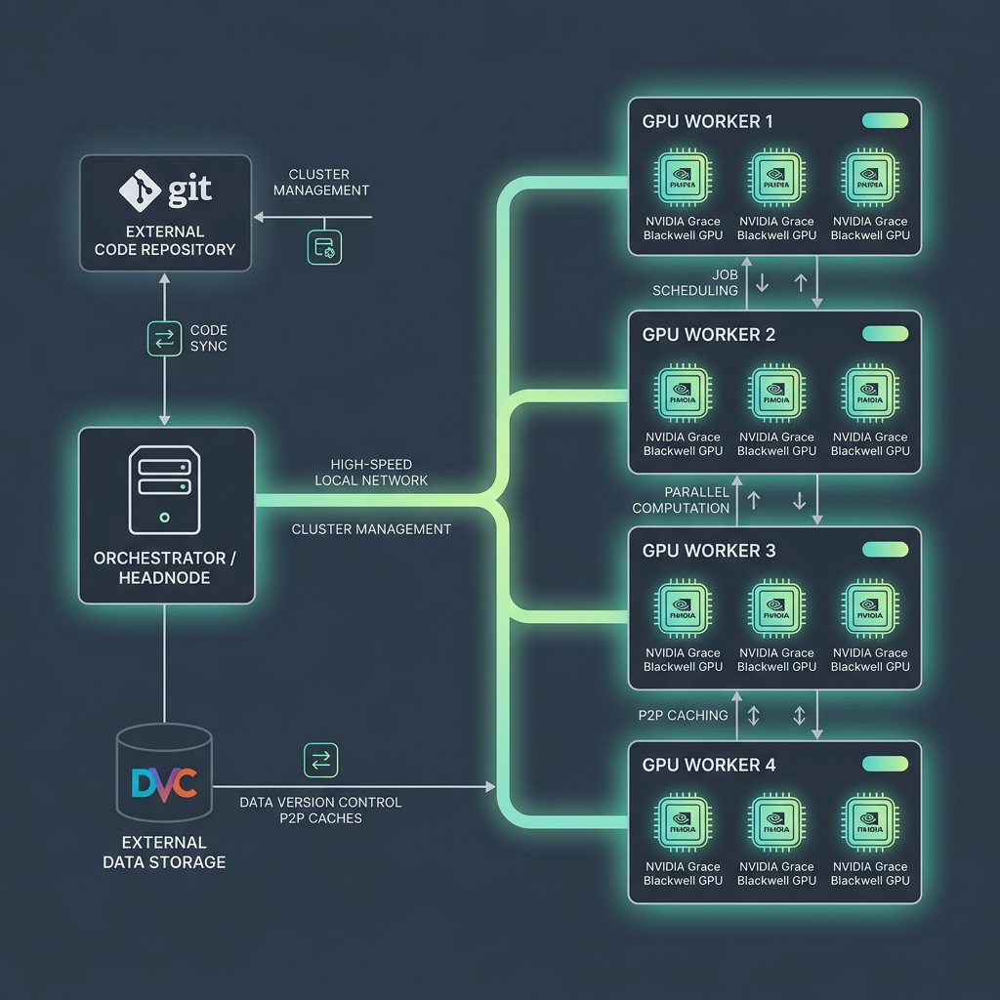
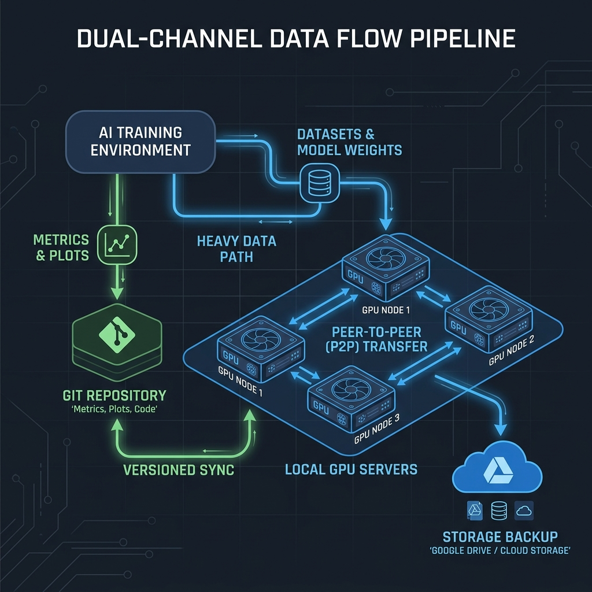

# Infrastructure Internals

This document provides detailed technical documentation on the internal mechanisms of the Cluster-CI platform. These details are intended for **platform administrators and developers** who need to understand, maintain, or debug the underlying systems. Researchers do not need to read this document to use the cluster.

---

## Architecture Overview

Below is the high-level technical architecture of the Cluster-CI platform showing the interaction between the headnode, the workers, GitHub Actions, and the remote storages.



---

## 1. Garbage Collection

The cluster implements a multi-tiered, Least Recently Used (LRU) garbage collection system to manage disk space on worker nodes (`src/runner/gc_orchestrator.py`).

### Tiered LRU Garbage Collection Architecture

To prevent worker hard drives from filling up, the runner executes a JIT cleanup routine before and after each job run:

*   **Standard Eviction Threshold**: Triggered when partition free space drops below **100 GB** (`FREE_SPACE_THRESHOLD_GB = 100`).
*   **Panic Threshold**: Escalates if free space drops below **50 GB** (`PANIC_THRESHOLD_GB = 50`), running aggressive pruning.
*   **Active Job Protection Window**: Any workspace with an active container or whose execution finished within the last **6 hours** (`GC_PROTECT_HOURS = 6.0`) is strictly protected against eviction.
*   **Project Metadata Registry**: Maintains `repositories/registry.json` tracking project usage (`status: "idle"|"running"`, `last_execution` timestamp, and disk footprint).

#### Strict 5-Tier Eviction Hierarchy

When free disk space is below threshold, `gc_orchestrator.py` sequentially iterates through 5 hierarchical cleanup tiers, stopping immediately once free space exceeds the target threshold:

| Tier | Category | Targets & Actions | Safety Guarantees |
| :--- | :--- | :--- | :--- |
| **Tier 1** | **Regenerable Caches** | - `docker system prune -f`<br>- `dvc gc --workspace --rev HEAD`<br>- Caches under `.cache/uv`, `.cache/pip`, `.cache/huggingface`, `.cache/torch`, and `__pycache__` | **Zero loss**: Never deletes `.venv` directories, Git history, or tracked repository files. |
| **Tier 2** | **Inactive Docker Volumes** | Deletes idle named Docker home volumes (`cluster-ci-home-*`) belonging to inactive projects. | Cached wheels are cleared; packages will be re-installed from locks on next run. |
| **Tier 3** | **Stale DVC Cache Entries** | Cleans shared and local DVC cache files for the oldest idle repositories according to the LRU registry. | Only unreferenced DVC hashes are removed; remote backups remain intact. |
| **Tier 4** | **Unused Docker Images** | Prunes dangling and unused Docker images in LRU order (`docker image rm`). | Images currently referenced by active or stopped containers are strictly preserved. |
| **Tier 5** | **Full Inactive Workspaces** | Deletes complete workspace directories under `repositories/` for the least recently used idle projects. | **Last Resort**: Executed only after Tiers 1–4 are exhausted and disk space remains critical. |

Active repositories currently running jobs are **never** targeted by any tier of the GC.

---

## 2. Historical DVC Visualizer

The historical visualizer allows researchers to view pipeline DAGs, metrics, and plots for older revisions without interfering with the active workspace. It utilizes isolated Git worktrees and cached symlinks.

1.  **Git Worktree Isolation**: When a historical view request is sent to the headnode for a repository at a specific commit revision, the worker API endpoint `/api/worker/dvc-viewer/start` (in `src/scheduler/worker_agent.py`) is invoked. It creates a deterministic directory in `/tmp/dvc-viewer-<repo>-<rev_short>` and executes:
    `git worktree add --detach <worktree_dir> <target_rev>`
    This checks out the specified commit in an isolated directory without affecting the worker's main branch workspace.
2.  **Local DVC Cache Symlinking**: To avoid time-consuming network pulls, the worker creates a `.dvc` folder inside the newly created worktree, symlinks the main repository's DVC cache (`repo_path/.dvc/cache` -> `worktree_dir/.dvc/cache`) and copies the `config` and `config.local` configuration files. It then runs:
    `dvc checkout`
    This restores all heavy outputs instantly from the shared local DVC cache, without making network requests.
3.  **Inactivity Heartbeats**: The `dvc-viewer` server (launched in `dvc_viewer/server.py`) spawns a background thread named `_inactivity_daemon`. This daemon monitors server activity. If no client requests hit the `/api/heartbeat` endpoint for 15 consecutive seconds, the server self-destructs by calling `os._exit(0)`. While the user's browser is active, it pings the proxy on the headnode every 5 seconds, which forwards the heartbeat to the worker to keep the instance alive.
4.  **Headnode Cleaning Task**: In `src/scheduler/headnode_service.py`, a background thread `cleanup_inactive_viewers()` runs every 30 seconds:
    *   For **local** viewers: if the last access exceeds `DVC_VIEWER_TIMEOUT_MIN` (defaults to 30 minutes), it terminates the process (`proc.terminate()`).
    *   For **remote** worker viewers: if the last access is older than 45 seconds (since the worker itself terminates after 15 seconds of inactivity), the headnode prunes the metadata registration entry.

---

## 3. Container Hardening

The `src/runner/smart_install.sh` script implements several protective mechanisms to ensure that the NVIDIA NGC container runtime remains stable despite user dependency installations.

### NGC Library Shadowing Protection
NVIDIA NGC containers contain highly-optimized, hardware-accelerated builds of libraries (e.g. `torch`, `triton`, `vllm`, `nvidia-*`) pre-installed in system directories (such as `/usr/local/lib/python3.12/dist-packages/`).

1.  **The Shadowing Problem**: When running local pip/uv installations (e.g., `pip install -e .` with local prefixes or user directories), transitive dependencies can pull standard public PyPI packages into `/home/user/.local/lib/python3.12/site-packages/`. Since Python prioritizes local paths over system paths, these generic PyPI packages shadow the optimized NGC builds, causing massive performance drops or CUDA crashes.
2.  **Protection Mechanism**: To prevent this library shadowing, `smart_install.sh` executes a post-install hook that scans all Python site-packages and dist-packages paths under the user's home folder (`/home/user/.local/...`, `/workspace/.venv/...`, etc.) and forcibly removes (`rm -rf`) any directory matching:
    `torch`, `torch-*`, `torchvision`, `torchvision-*`, `nvidia*`, `nvshmem*`, `triton*`, `xformers*`, and `vllm*`.
    This ensures the Python runtime always falls back to the vendor-optimized system libraries provided in the NGC container.

### vLLM NVSHMEM Stub Symlinking
When compiling or launching `vLLM` in multi-GPU clusters, the build searches for the NVSHMEM communication library (`libnvshmem.so`).

1.  **Single-GPU Worker Absence**: On single-GPU worker nodes, the NVSHMEM runtime is typically absent, which causes vLLM startup to fail with library loading errors.
2.  **Stub Symlink Fix**: During the dependency setup phase, `smart_install.sh` uses a Python script to locate the active PyTorch library directory (`torch/lib`) and automatically symlinks the NVIDIA CUDA stub:
    `ln -sf /usr/local/cuda/lib64/stubs/libnvshmem.so <torch_lib_path>/libnvshmem.so`
    This provides vLLM with the required interface definitions, preventing initialization errors on single-GPU nodes.

### bitsandbytes CUDA Compatibility Patch
The `bitsandbytes` quantization package loads pre-compiled CUDA backend libraries (e.g., `libbitsandbytes_cuda120.so`).

1.  **Compatibility Barrier**: When running on cutting-edge platforms like Grace Blackwell (GB10) with newer CUDA drivers (e.g., CUDA 13.2), `bitsandbytes` fails because it does not ship with a matching pre-compiled library for that major/minor version.
2.  **Dynamic Patching**: `smart_install.sh` detects the system CUDA version via `nvcc --version` (e.g. `132` for `13.2`), and scans the `bitsandbytes` site-packages directory to locate the highest pre-compiled `.so` file available (e.g. `libbitsandbytes_cuda126.so` for `12.6`). If the host CUDA version exceeds the highest pre-compiled version and the corresponding `.so` is missing, it dynamically symlinks:
    `ln -s libbitsandbytes_cuda126.so libbitsandbytes_cuda132.so`
    This forces `bitsandbytes` to load and run using the latest compatible CUDA library.

---

## 4. Runtime Watchdogs

The cluster employs several watchdog processes to ensure job stability and prevent resource exhaustion.

### Double-Threshold GPU Memory Guard & Host Watchdog
To prevent jobs from freezing the operating system or starving other tasks on unified memory platforms (such as NVIDIA Grace Blackwell GB10), `cluster-ci` implements a double-threshold memory protection system.

1.  **Process-Level CUDA Hard-Cap**: The script `src/runner/gpu_memory_guard.py` is injected into the container's `PYTHONSTARTUP` environment variable. Before user code executes, it checks `CLUSTER_CI_VRAM_LIMIT_GB`. If set, it calculates the VRAM fraction and hard-caps PyTorch's memory allocation via:
    `torch.cuda.set_per_process_memory_fraction(fraction, device=0)`
2.  **Unified Memory (Grace Blackwell GB10) Architecture**: On unified memory systems, CPU and GPU share a single physical NVLink-C2C memory pool (128 GB). Standard CUDA device queries for total memory return `0` or `[N/A]`. The guard detects this architecture and falls back to reading system RAM from `/proc/meminfo` (`MemTotal:`), dynamically enforcing limits against the shared pool.
3.  **Host-Level Dual Threshold Watchdog**: The host script `src/runner/gpu_watchdog.sh` monitors the running container every 2 seconds:
    *   **Discrete GPU Mode**: Queries `nvidia-smi --query-gpu=memory.used`.
    *   **Unified Memory Mode**: Fallback to `/proc/meminfo` (`MemTotal - MemAvailable`).
    *   **Soft VRAM Threshold (User-declared)**: If memory exceeds this limit, it flags a violation. If the violation persists for `SOFT_THRESHOLD = 2` consecutive checks (4 seconds grace period), the watchdog kills the container (`docker kill`).
    *   **Hard Host Guard Threshold**: If host free memory drops to `MemAvailable < 12 GiB` or total system RAM usage exceeds **90%**, the watchdog immediately kills the container on the very first check to protect the host OS from kernel panics, freeze, or unrecoverable lockups.

#### Forensic Exit Code 137 Diagnosis (`host_guard_killed.marker` vs `OOMKilled`)
When a stage terminates abruptly with exit code `137` (SIGKILL), the execution runner performs an automated forensic check to distinguish host-level emergency eviction from container-level quota exhaustion:

*   **Host Guard Emergency Termination (`host_guard_killed.marker`)**:
    When `gpu_watchdog.sh` kills a runaway container to protect the server (`MemAvailable < 12 GiB` or RAM > 90%), it drops a marker file `host_guard_killed.marker` in the job directory. The runner catches this file and reports:
    ```text
    HostMemoryPressureExceeded: Stage '<stage>' was terminated by the host memory watchdog.
    Cause: Available system memory fell below 12 GiB (or exceeded 90% capacity).
    Remedy: Decrease concurrency, reduce DataLoader workers, or schedule on a worker with larger capacity.
    ```
*   **Container Quota OOM Killer (`OOMKilled`)**:
    If no marker file exists, the runner inspects container metadata via `docker inspect --format '{{.State.OOMKilled}}'`. If `true`, the container was terminated by the Linux cgroup OOM Killer for exceeding its own declared memory envelope (`meta.cluster.ram_gb` or `vram_gb` on GB10). The runner prompts the researcher to increase `ram_gb` in `dvc.yaml`.

### Zombie GC (Multi-dimensional Inactivity)
To prevent orphaned or stuck container processes from indefinitely consuming cluster resources, `src/runner/gc_orchestrator.py` runs a **Zombie Garbage Collection** daemon via `run_zombie_gc()`.

1.  **Container Filtering**: The GC scans for running Docker containers matching the name pattern `cluster-job-*`.
2.  **Multi-Dimensional Inactivity Check**: For each container, it evaluates activity across three dimensions:
    *   **Logs**: Checks the modification timestamp (`st_mtime`) of `job_logs/{job_id}.log`. If the log file has not been modified since the last check, it counts as inactive.
    *   **CPU & Network**: Queries `docker stats` for CPU percentage and network IO bytes. If CPU usage is `<= 0.1%` and network traffic is identical to the previous check, it counts as inactive.
    *   **GPU Utilization**: Runs `nvidia-smi` to verify if the sum of GPU utilization percentages is `0%`.
3.  **10-Minute Timeout Termination**: If inactivity is detected across all three dimensions, a persistent timer is incremented in `zombie_registry.json`. If this inactivity exceeds `ZOMBIE_TIMEOUT_MINUTES = 10` minutes, the container is forcibly removed (`docker rm -f`), and any associated viewer containers or host `dvc-viewer` processes are killed.

### DVC Git Watchdog (Incremental Backups)
The cluster implements an asynchronous watchdog (`src/runner/dvc_watchdog.sh`) to perform intermediate Git commits of metrics and plots during long-running training stages.

1.  **Lock File Monitoring**: The watchdog runs as a host-level background daemon, polling the project's `dvc.lock` file every 2 seconds.
2.  **DVC Status Interlocking**: When `dvc.lock` is modified, the script waits 2 seconds for disk writes to settle. It inspects `.dvc/tmp/iterative-status.json`. If the JSON file reports `running: true`, it defers the synchronization to prevent file locking conflicts.
3.  **Intermediate Commits**: If no stage is actively writing, it executes `dvc_git_helper.py sync` inside the container:
    *   **Staging changes**: Stages `dvc.lock` if modified. It reads `dvc.yaml` to identify all metrics/plots files configured with `cache: false`.
    *   **Size Constraint**: If a metric file is `< 5 MiB` and has local modifications, it is staged via `git add -f <path>`. Files `>= 5 MiB` are skipped to protect repository size.
    *   **Push Reconciliation**: Commits the files under `cluster-ci-bot` (`bot@cluster-ci.io`) with `[skip ci]` tags. It then runs `git push origin HEAD`. If the push fails, it executes `git pull --rebase` to resolve remote updates, pushes again, and aborts (`git rebase --abort`) if conflicts cannot be resolved.

---

## 5. Data Flow and Code-to-Artifact Lifecycle

The diagram below details the data flow, showing how repositories are checked out, how DVC caches are symlinked and synchronized, and how outputs are pushed back to remote storage.


